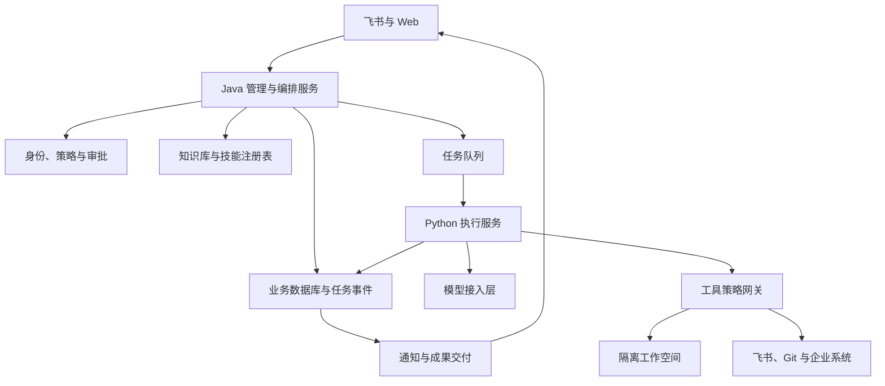

# BunBird 企业协作智能体平台建设方案 v0.1

日期：2026-09-12。状态：第一版设计方案，尚未实施或完成性能验证。

本方案依据《简历.md》《呆呆鸟.md》及前轮已核对的后台截图，覆盖对话编程、企业知识问答、飞书协作、技能市场、资产组、身份权限、模型路由、分层记忆、质量验证与失败兜底。项目暂名 BunBird，可后续统一更名。材料中的既有系统架构推测仅作为需求线索，不作为原系统源码事实。

## 1. 建设目标与实施假设

建设一个以飞书为日常入口、Web 后台为管理入口的企业智能体平台。员工在群聊或私聊提出需求，平台识别用户和权限，确定项目、知识库及技能配置，调度 Agent 完成代码修改、调试、知识检索或办公操作，并提供可追踪的执行过程、验证证据和交付成果。

第一版采用“Java 模块化管理服务＋独立 Python Agent 执行服务”的结构。Java 负责业务状态、权限和调度，Python 负责模型交互与工具执行。初期调用现有模型服务，不训练基础大模型；GLM、Qwen 等作为可配置模型系列，具体型号在接入时通过工具调用、中文能力、上下文与成本评测选择。

按内部小规模试点规划：先支持 Java Maven/Gradle 与 Node.js 两类代码仓库、一个企业飞书应用、少量部门和知识库。全部功能属于最终交付范围，分期安排不代表删除需求。Python 等仓库模板、多执行节点和更多消息平台通过同一接口扩展。

前提条件包括：可管理的飞书应用、获准接入的 Git 仓库与测试数据、模型 API 额度、可运行隔离容器的 Linux 环境、测试命令或可确认的构建规范，以及至少一名业务验收人员。初期不需要 GPU；若后续私有化部署模型，再单独评估显存与推理服务。

## 2. 用户、入口与完整功能范围

| 模块 | 最终交付功能 | 核心成果 |
| --- | --- | --- |
| 飞书接入 | 私聊、群聊、@触发、话题回复、流式卡片、消息去重、图片与附件、消息编辑策略 | 可连续使用的任务入口 |
| Topic 协作 | 话题创建、任务上下文、参与者、订阅/取消订阅、状态通知、取消和继续任务 | 团队共享任务空间 |
| Agent 引擎 | ReAct 工具循环、四类消息、工具结果回填、任务计划、失败修正、CLI | 可独立运行的执行服务 |
| 任务委派 | 父子任务、串并行依赖、结果汇总、取消传播、任务预算 | 可控的复杂任务拆分 |
| 模型路由 | 按任务选择模型、能力检查、限流、超时、备用模型、成本记录 | 可替换的模型接入层 |
| 记忆 | 当前会话、Topic 摘要、项目长期知识、个人偏好、Token 压缩 | 长任务与跨轮续接 |
| 代码工作空间 | 拉取仓库、独立 worktree、分支、容器、依赖准备、提交、普通推送、PR | 可追踪的代码交付 |
| 质量验证 | 语法、lint、类型、构建、定向测试、回归、红绿灯、基线对照 | 独立于模型的验证记录 |
| 失败兜底 | 错误分类、有限重试、环境修复、模型降级、断点恢复、人工接管 | 不隐瞒失败的任务闭环 |
| 企业知识库 | 文档导入与同步、解析、分块、向量召回、BM25 重排、引用、权限过滤 | 有来源的知识问答 |
| 身份与权限 | 企业身份识别、外部绑定码、多租户、RBAC、资源 ACL、授权撤销 | 贯穿全链路的访问控制 |
| 技能市场 | 技能发布、版本、命名空间、检索、详情、启停、审核、引用统计 | 可复用的技能资产 |
| 资产组 | 技能组合、所有人、可见性、版本绑定、关联群 | 面向部门的能力配置 |
| 我的群 | 群所有权、资产组关联、SkillHub 开关、管理员转交 | 群能力与责任归属 |
| 我的智能体 | 身份、绑定记录、授权、SkillHub 账户、命名空间、已发布技能 | 个人管理入口 |
| 上游订阅 | GitHub 来源、定时同步、扫描、变更预览、版本发布、失败重试、回退 | 可治理的外部技能引入 |
| 企业办公工具 | 飞书文档、云盘、多维表格、通讯录；Git 与只读数据库查询 | 编程之外的协作能力 |
| 运维治理 | 审批、日志、审计、配额、费用、告警、备份恢复、执行节点管理 | 可维护的企业服务 |

角色初设为平台管理员、租户管理员、部门/资产组管理员、群负责人、技能作者、普通用户、审计人员。角色不自动拥有所有业务数据读取权，资源访问仍检查 ACL。

## 3. 总体架构与服务边界

Java 服务先做模块化单体，按 identity、conversation、task、skill、asset、knowledge、approval、audit 划分模块，不在第一阶段拆成大量微服务。Agent Worker 独立部署，因为执行代码的资源需求与风险边界不同于管理后台。

管理服务是任务、权限、审批和配额的唯一权威来源；Worker 可以上报进度与申请工具，不能自行扩大权限或将失败改成成功。任务状态以 PostgreSQL 为准，Redis 用于排队、事件分发和短期缓存。数据库事务内写入任务及 outbox 事件，异步投递队列，避免“任务已创建但队列丢失”。

参考项目采用按模块借鉴的方式：cc-connect 用于研究消息平台与 Agent 适配；OpenHands SDK 作为首选执行引擎候选；iflytek/skillhub 用于研究技能发布、版本与权限。三者不是默认可以直接拼装的完整系统，身份、任务协议和资源权限由 BunBird 统一定义。[cc-connect](https://github.com/chenhg5/cc-connect)、[OpenHands SDK](https://github.com/OpenHands/software-agent-sdk)、[SkillHub](https://github.com/iflytek/skillhub)。

## 4. 技术选型与复用策略

| 层次 | 初版建议 | 选择理由与边界 |
| --- | --- | --- |
| 管理后端 | Java 21＋Spring Boot，版本在开发启动时锁定 | 便于实现企业权限、事务和后台业务 |
| 前端 | React＋TypeScript＋Ant Design | 覆盖列表、表单、版本详情和任务控制台 |
| Agent Worker | Python＋OpenHands SDK 适配器 | 优先复用工具与会话引擎，平台自行持有业务状态 |
| 替代执行器 | CLI Adapter 接入已有编程 CLI | 仅在能力映射、事件与权限验证通过后开放 |
| 业务存储 | PostgreSQL | 事务、任务、权限、消息、版本与审计索引 |
| 队列与缓存 | Redis Streams＋消费者组 | 试点规模下管理成本较低，配合 outbox 和幂等消费 |
| 检索 | OpenSearch | 统一承载向量与词法检索；中文分词和索引配置需验证 |
| 文件存储 | 组织现有 S3 兼容对象存储 | 技能包、文档、附件、日志与测试报告 |
| 运行隔离 | 专用 Worker 主机上的非特权容器 | CPU、内存、进程、磁盘与网络分别限制 |
| 观测 | OpenTelemetry＋Prometheus/Grafana，结构化日志 | 任务链路、模型耗时、工具错误与资源使用 |
| 初始部署 | 管理侧 Compose，Worker 独立主机/服务 | 先压低运维复杂度，规模增长再评估 Kubernetes |

OpenHands SDK 提供代码 Agent、工具与工作空间抽象；应先做一轮技术验证，确认所选模型工具协议、结构化事件、取消、恢复、技能加载和审批接入满足要求。SDK 不匹配时通过 Adapter 替换，不改变上层任务协议。[官方仓库](https://github.com/OpenHands/software-agent-sdk)。

不同时维护多个 ReAct 引擎。BunBird 自定义的是统一会话协议、资源边界和质量流程；若复用 SDK，就不把 SDK 已有循环再重写一遍。可提供 bunbird run、bunbird resume、bunbird inspect 作为 CLI 入口，调用同一任务服务；本地开发模式需明确标识为非企业隔离环境。

## 5. 飞书、Topic 与消息处理

接入层接收平台事件后，先验证来源，再按 tenant_id、app_id、event_id 建立唯一记录。快速确认接收，将长任务移到后台。重复事件不重复创建任务。图片和附件先下载到任务附件区并记录来源，大小和类型受限制。

Topic 以租户、群和根消息/话题标识关联，Topic 下可有多轮 Run。订阅 Topic 只增加通知关系，不增加资源访问权。默认同一 Topic 的代码写任务串行；只读检索或显式子任务可并行。执行中新增消息区分为补充指令、下一轮任务和取消请求，所有消息按序留存。

共享群输出必须考虑整个群的可见范围：不能把发起者个人有权访问、其他成员无权访问的文档片段直接发到群里。初版将群知识库限制为已授权给群范围的资源；超出范围的结果只在经过鉴权的私聊或 Web 页面展示。

支持查看状态、取消、继续、订阅、取消订阅及受权限控制的模型切换。长任务先发送已受理卡片，按阶段合并更新，避免每个 Token 都调用飞书 API。任务结果与消息送达分别记录；发送失败只重试通知，不重新执行代码任务。

附件兼容 Topic 专属追加队列：每个 Run 使用独立清单，平台验证文件存在、真实路径、权限和类型，生成 Artifact 记录后上传。禁止任意绝对路径外传、目录入队及符号链接越界。交付端用 artifact_id 幂等发送；不依赖 Agent 自行写“发送成功”。

## 6. 任务状态机、Agent 与子任务

任务主要状态为 RECEIVED、QUEUED、PREPARING、RUNNING、WAITING_APPROVAL、VALIDATING、SUCCEEDED、PARTIAL、FAILED、CANCELLED。重试产生新的 attempt，不覆盖历史。WAITING_APPROVAL 不长期占用执行槽，超时进入可恢复的暂停/失败分支；状态转换须带数据库版本条件。

每次 Run 固定保存仓库基线 SHA、模型配置、技能包哈希、政策版本、知识检索版本和输入附件引用。Worker 领取任务后持有有时限的租约与 fencing token；只有最新有效执行代次可写任务状态和申请外部动作。租约失效先停止旧进程，不能让新旧 Worker 同时向同一分支写入。

Agent 循环依次完成：构建上下文、请求模型、解析工具调用、平台策略校验、执行工具、保存结果、继续生成或进入验证。保存可审计的计划、工具输入输出、结果与摘要，不要求存储模型私有推理过程。

消息协议统一 system、user、assistant、tool 四类，包含 message_id、parent_id、run_id、sequence、tool_call_id、内容类型、时间和 Token 用量。工具参数通过 JSON Schema 校验；结果必须关联原 tool_call_id。无效 JSON、未知工具、结果缺失分别产生明确错误，不将失败当正常结果回填。

设定每个 Run 的总时限、最大工具步数、最大模型费用和单工具超时，作为可配置初值，例如 30 分钟、60 步、工具默认 120 秒；构建测试可单独延长。连续无进展、重复同一失败或预算用尽转人工接管，不能无限循环。

任务委派采用有向无环依赖图，第一版最多两层、最多三个并发子任务作为试点默认值。子任务独立工作空间与预算，继承父任务权限的子集。由主任务整合补丁，解决冲突后在合并结果上重新验证；子任务各自通过测试不等于组合结果通过。

## 7. 工作空间、并发隔离与 Git 交付

平台为每个代码任务准备唯一 workspace_id、受控仓库副本、固定基线 SHA 和 task 分支，执行 worktree 创建并核验成功后才允许写文件。已有用户目录不作为任务临时区，避免覆盖未提交改动。worktree 失败必须停止准备，不能回退主目录继续改代码。

worktree 只解决文件与分支工作区冲突，不构成安全沙箱。由于 worktree 共享 Git 元数据，初版在任务独立仓库副本内部建立 worktree；不向不同租户挂载共享可写 Git 对象库。后续优化缓存时仅复用只读依赖与经校验的仓库缓存。

每个任务容器使用非 root 用户，限制 CPU、内存、PID、磁盘与运行时间；不挂载宿主 Docker socket，不注入管理数据库凭据，不暴露其他任务目录。依赖缓存按信任范围分区；测试数据库、端口和临时目录使用任务命名空间，防止代码隔离了但数据库互相污染。

执行前检查 git status 与基线，任务结束由平台收集 diff、文件列表和测试记录。保留平台创建的检查点，失败时可恢复该任务的检查点；不对用户目录执行破坏性重置。普通 push 和 PR 创建由受控 Git 工具完成，凭据只授予对应仓库与任务分支；主分支合并和 force push 不在默认自动授权范围。

默认交付经过验证的分支和 PR；用户/组织已预先授权该仓库普通推送时直接执行，无须每次重复确认。若无推送权限，交付补丁和验证报告并说明状态。目标分支发生变化时，合并前基于新目标重新集成并验证，不能使用旧结果为新提交背书。

## 8. 质量验证与红绿灯机制

质量模块独立于 Agent，读取实际命令退出码、测试报告和 Git SHA 产生结论。先识别仓库已有构建文件、CI 与脚本，匹配 Java/Node.js 模板；对无法确认的项目要求管理员补充 profile，不能承诺任何仓库无配置都能正确执行全量回归。

| 阶段 | 处理方式 | 证据 |
| --- | --- | --- |
| 基线 | 修改前记录依赖、环境及必要的现有检查 | base SHA、命令、结果 |
| 语法与静态 | 编译诊断、lint、类型检查 | 退出码与诊断位置 |
| 定向测试 | 根据变更模块和测试映射选择已有测试，必要时补回归用例 | 测试列表、断言结果 |
| 回归 | 执行仓库声明的完整测试集合，高风险改动必须覆盖集成验证 | 范围、通过/失败/跳过数量 |
| 修复 | 将失败证据交给 Agent，有限次数修复 | 每次 diff 与结果变化 |
| 最终 | 在最终交付 SHA 上检查，不允许验证后继续改文件仍沿用旧结果 | 最终 SHA、配置、产物哈希 |

对于 bug 修复，适合时采用“新增用例在原基线失败、修复后通过”的红到绿验证。测试有效性也要检查，禁止删除断言、忽略测试或放宽预期来制造绿灯。

绿灯：本任务要求的检查全部通过且与最终 SHA 对应；黄灯：存在未执行项、环境阻塞、已确认基线失败或证据不足；红灯：出现新增失败、构建失败或明确行为不符合要求。取消、超时和未知状态不能记为绿灯。

定向测试通过不能证明全量失败一定来自旧代码。需要在隔离基线环境下以相同配置重跑失败用例；若基线也失败，记录为基线问题，但仍检查失败模式是否相同。随机失败须重复运行并单独标记，不用多数通过掩盖不稳定性。

项目验证 profile 保存镜像摘要、安装命令、构建命令、定向与全量测试命令、超时和允许副作用。通过只表示声明范围内检查通过，不表示没有任何缺陷。

## 9. 失败分类、重试与恢复

| 类别 | 自动处理 | 终止或接管条件 |
| --- | --- | --- |
| 模型限流/短时网络失败 | 指数退避、抖动，建议最多三次；可切换允许的备用模型 | 总预算或时限耗尽 |
| 工具参数错误 | 回填结构化错误，允许模型纠正 | 连续重复同一错误 |
| 代码/测试失败 | 最多三轮针对性修复作为默认策略 | 无进展或范围持续扩大 |
| 依赖/环境失败 | 检查镜像、依赖锁文件和网络，允许一次环境重建 | 需要新增外部授权或无法复现 |
| Worker 崩溃 | 租约回收、检查点恢复、核对未完成工具 | 外部副作用结果未知 |
| 权限不足 | 返回资源与缺失权限，进入审批或拒绝 | 不自动换身份或扩大权限 |
| 附件/通知失败 | 仅重试交付步骤 | 平台限流持续或资源已不可见 |

只读操作可重试；创建 PR、写文档、写数据库等操作必须具备幂等键或执行后查询机制。对响应超时但可能已经成功的写操作先对账，不能盲目重放。Agent 引擎不能可靠恢复内部会话时，新建会话并注入结构化检查点，重新核对当前文件与工具结果，避免伪称精确续跑。

人工接管包包括需求、计划、当前状态、diff、失败命令、日志摘要、已尝试方案、未解决问题和继续入口。失败结果与成功结果都保留可追踪记录。

## 10. 分层记忆与上下文压缩

| 层次 | 内容 | 更新策略 |
| --- | --- | --- |
| 运行短期上下文 | 最近消息、未闭合工具调用、当前步骤 | 每轮更新，保留必要的调用结果对 |
| Topic 记忆 | 目标、限制、决策、进度、失败尝试、待办 | 阈值触发结构化摘要 |
| 项目记忆 | 架构、构建方式、约定、经确认的故障经验 | 带来源与版本，验证后写入 |
| 用户/组织偏好 | 语言、格式、默认模型等 | 限权限、可查看和删除 |

以可用上下文预算的约 70% 作为试点压缩触发值，预留系统规则、工具结果及输出空间，最终按模型和任务评测调整。压缩旧的完整轮次，不拆开 assistant 工具请求与 tool 结果，不压掉当前权限规则和未完成动作。

摘要固定字段为目标、约束、已完成、有证据的结论、失败尝试、当前工作空间、待处理审批和下一步。摘要保存原消息范围和版本。日志全文外置，模型只获得相关片段及引用。撤销文档权限后，后续上下文组装也要移除来自该文档的缓存和摘要片段。

每条长期记忆带 tenant_id、project_id 或 user_id、来源、有效期与 ACL。模型提出的记忆不能直接成为企业事实；涉及项目规范的更新需验证或确认。

## 11. 模型路由与预算

统一模型接口支持消息、流式事件、工具调用、用量和错误分类。路由先按数据允许流向、工具能力、上下文长度筛选，再按任务类型与成本选择，不能只按价格。

建议将任务分类与简单摘要分给低成本模型，复杂代码修改分给代码能力通过评测的模型，知识问答使用中文与引用能力稳定的模型，图片理解使用具备视觉能力的模型。GLM、Qwen 等通过配置接入；不假设所有兼容 API 都具有相同工具调用行为。

会话默认固定执行模型，切换时保留结构化上下文和已完成工具记录。备用模型必须满足相同数据政策与工具能力，不能因服务不可用把企业数据转给未授权提供方。

按租户、用户、项目与 Run 记录输入/输出 Token、缓存用量、模型费用、容器耗时和并发槽。设置每日/月度配额与任务预算；接近上限提醒，达到硬上限暂停并保留结果。降低等待时间优先依靠镜像预热、依赖缓存、合理测试范围和减少无效循环。

## 12. 企业知识库与权限检索

数据源覆盖上传文件、飞书文档/Wiki、获准代码文档和组织知识资料。导入流水线执行解析、分块、去重、来源与版本记录、ACL 同步、向量化、索引发布。删除和撤权事件同时使索引与回答缓存失效；全量对账修复漏掉的增量事件。

初版按材料实现“权限范围内向量召回→BM25 重排”：topK 先设为 5，recallK 初设为 min(30×topK,候选上限)，例如候选上限 300，均可配置。BM25 采用明确的中文分词与索引统计，对候选片段计算查询相关度；排序以 BM25 为主、向量为辅助，可先用词法主排序与向量同分排序避免混加不同量纲分数。

该策略是候选内词法重排，不是天然等价于向量与 BM25 双路召回；如果向量阶段漏掉关键术语，后续无法补回。评测后可切换为双路召回＋RRF 融合，再选配重排模型，并保留原策略作为对照。

权限过滤在检索前进入服务端查询，在结果返回和引用打开时再次鉴权。tenant_id 从登录上下文生成，不接受模型或客户端随意指定。缓存键包含权限范围/ACL 版本、索引版本和查询条件，防止跨用户缓存泄漏。平台公开、租户公开和指定群可见分别建模。

回答附文档标题、版本、片段位置和可访问链接。没有充分依据时明确说明，不能生成不存在的出处。文档中的命令和提示不获得工具授权，检索内容始终作为数据进入上下文。

## 13. 身份、权限与外部动作

企业飞书用户经已验证的应用事件与组织信息映射到平台账户，不依赖显示姓名自动匹配。飞书外部身份通过一次性绑定码关联已登录的平台用户：代码绑定应用、外部身份和发起上下文，保存哈希，短期有效，使用后失效，限制错误次数。初版可采用八位随机码、30 分钟有效期，并加入频率限制。

身份绑定与访问授权分离：绑定成功不等于加入某租户、获得企业 OAuth 许可或能访问群资源。外部用户须通过明确的成员关系和授权范围获取能力。

授权判定采用租户范围＋RBAC＋资源 ACL＋当前动作策略。资源包括群、Topic、仓库、知识库、文档、技能、资产组、模型和执行器。前端隐藏按钮仅改善体验，后端每次查询、执行和下载都检查权限；撤权后重新检查排队任务和未执行动作。

工具分为任务空间内低风险动作、预授权外部动作和需要单次审批的动作。任务内部编辑和隔离测试可自动执行；组织预授权的任务分支 push、当前 Topic 状态回复在授权内执行；线上部署、业务数据写入、权限调整、业务文件删除和对外发送等按策略提交具体动作审批。

审批绑定操作者、资源、参数摘要/哈希、有效期、允许次数与回滚说明；参数变化必须重新判定。Skills、项目规则和模型输出均不能降低平台约束。CLI 执行器如无法接入同等强制控制，不开放企业敏感工具；不以一段 system prompt 代替拦截。

凭据由连接器或凭据服务管理，日志脱敏；Worker 不获得平台级凭据。任意 shell 的约束主要依赖隔离、最小权限和网络边界，不能只靠命令关键词过滤。

## 14. 技能市场、资产组与上游订阅

技能包包含 SKILL.md、可选脚本、模板与参考资料，平台补充 skill_id、namespace、owner、version、内容哈希、可见性、所需工具、运行环境、来源和审核状态。技能发布后版本不可变，修订发布新版本；停用与回退通过绑定关系处理。

技能生命周期为草稿、待扫描、待审核、已发布、停用。扫描覆盖路径穿越、解压体积、符号链接、危险脚本、疑似凭据与依赖风险；扫描通过只代表检查规则通过，不能保证任意代码安全。安装脚本不在管理服务运行。

技能市场提供名称/描述/作者/命名空间检索、版本展开、群引用数、更新时间、详情、订阅和发布。SkillHub 账户是平台账户的技能功能开通记录，不另建一套无法对齐的身份体系。可在开通 SkillHub 的群内提出创建技能需求，Agent 生成草稿，由作者确认发布到其有权限的命名空间。

资产组是带版本的技能组合，例如“飞书基础”“开发基础”“部门业务”。资产组绑定确定的技能版本或显式更新策略，群绑定资产组，可多个组合。冲突时不静默选择：同名不同来源技能使用命名空间消歧；不兼容版本或互斥工具阻止配置生效并提示管理员解决。

会话初始化读取群配置，冻结本次 Run 的资产组版本和技能版本。先注入技能摘要，匹配任务时按需读取完整说明和必要资源；引用数与实际执行次数分别统计。在途任务不因上游更新改变行为，安全撤销例外：立即禁用相应工具并暂停受影响任务。

上游订阅保存 source_url、路径、跟踪分支/标签、最后 commit、包哈希、同步间隔、扫描状态与目标技能。定时检查使用分布式租约和唯一任务键；仅当内容变化时下载候选版本。固定下载提交，防止扫描与发布读取不同内容。

同步流程为发现变更、受限下载、解包校验、扫描、生成差异、审核、发布新版本。可信来源且无新增权限时可按管理员策略自动发布；“跟踪最新”不意味着所有群立即升级。群在下一次 Run 按配置使用通过审核的新版本，并保留回退能力。远程地址限制协议、域名、重定向和解析后的目标地址，防止订阅任务访问内部管理地址。

该部分借鉴 iflytek/skillhub 的技能包、版本、团队命名空间与治理思路；资产组—飞书群关联及本方案订阅流程属于 BunBird 自定义设计，不声称开源仓库已完整提供。[SkillHub 官方仓库](https://github.com/iflytek/skillhub)。

## 15. 企业办公工具与插件扩展

通过统一 Tool Registry 注册工具名称、参数 Schema、返回 Schema、超时、权限资源和副作用类别，可适配 MCP，但授权仍由平台执行。第一批工具覆盖文件读写、终端、代码搜索、Git、知识检索、飞书文档/Wiki、云盘、多维表格及通讯录。

飞书写操作按当前用户或明确的服务身份调用，返回实际创建/修改的资源标识。通讯录用于解析接收人，不能仅凭同名自动发送。数据库工具默认只读角色、只读事务、结果数量和查询耗时限制；需要写入时走单独连接与动作审批。文件下载和企业 API 的网络访问不与通用 shell 共享无限制凭据。

插件可以增加工具和技能，但不能修改核心鉴权。发布插件记录协议版本、运行依赖和兼容范围，升级前做契约测试。

## 16. 数据模型与接口草案

| 领域 | 主要实体 | 关键关系/约束 |
| --- | --- | --- |
| 身份 | tenant、user、membership、external_identity、binding_challenge | 外部身份按应用和身份标识唯一，绑定码单次使用 |
| 权限 | role、permission、role_binding、resource_acl、connection | 全链路租户范围与资源校验 |
| 群协作 | chat_group、topic、topic_member、topic_subscription | Topic 属于群，订阅不授予读取权 |
| 任务 | task、run、task_dependency、run_event、checkpoint、worker_lease | attempt/sequence 唯一，状态乐观锁 |
| 消息工具 | message、tool_call、tool_result | tool_call_id 精确关联，参数与结果保留哈希 |
| 工作空间 | repository、workspace、git_delivery | 固定 base SHA、工作分支和最终 SHA |
| 验证交付 | validation_profile、validation_run、artifact、delivery | 验证关联 SHA；任务完成和送达分开 |
| 模型费用 | model_config、route_policy、usage_record、quota | 配置版本与实际调用用量 |
| 记忆 | memory_entry、conversation_summary、memory_source | 作用域、来源、ACL 和有效期 |
| 技能资产 | skill、skill_version、namespace、asset_group、asset_group_version、group_binding | 内容不可变，运行版本快照 |
| 订阅 | upstream_subscription、sync_run、scan_report、review | 来源提交、包哈希与发布版本关联 |
| 知识库 | knowledge_base、document、document_version、chunk、ingest_job | 来源 ACL、索引版本、删除标识 |
| 治理 | approval、audit_event、outbox_event、idempotency_record | 具体动作授权、事件可靠投递 |

建议接口包括 POST /tasks、GET /tasks/{id}、POST /tasks/{id}/cancel、POST /tasks/{id}/resume、GET /runs/{id}/events、POST /topics/{id}/subscriptions、POST /skills/{id}/versions、POST /asset-groups、PUT /groups/{id}/bindings、POST /upstream-subscriptions、POST /knowledge-bases/{id}/documents、POST /approvals/{id}/decision。

Web 用 SSE 获取有序 Run 事件，断线后按 sequence 续取。Worker 使用独立认证的内部接口领取任务、心跳、上传事件和申请工具。事件包含 tenant_id、run_id、attempt、sequence、type、timestamp、payload_ref；大日志不直接塞入队列。

所有写接口支持幂等键；分页、下载、事件订阅也执行资源权限检查。分页和批量操作不得成为越权入口。

## 17. 管理后台页面

工作台展示任务数量、成功/部分完成/失败、执行时间、费用和待审批；任务详情展示计划、阶段、工具、diff、验证、交付和继续入口。其余页面包含智能体申请与开通、资产组配置、技能市场、我的群、我的智能体、上游技能订阅、知识库、仓库与验证模板、模型路由、成员权限、审批与审计。

统计口径需明确：技能数按逻辑技能计，版本数按已发布版本计，群引用按绑定关系计，使用次数按执行事件计。不要混用“订阅成功”“同步成功”“扫描通过”“已在群生效”这四种状态。

## 18. 部署、观测与运行成本

试点资源初始预算可按管理与检索节点 8 vCPU/16–32 GB RAM、Worker 节点 8–16 vCPU/16–32 GB RAM 估算，SSD 容量根据仓库、镜像和日志保留期选择。它只是容量规划起点，不是性能保证；Java 大仓库构建、OpenSearch 索引与并行容器需要实测调整。

初版默认两个代码执行槽，队列保留超额任务，按租户轮询避免单一租户占满。每个任务强制资源上限；管理接口与执行进程分开，避免编译吃满资源导致飞书入口无响应。

观测包括排队时间、模型首响应和总耗时、工具耗时、测试耗时、压缩次数、重试原因、取消生效时间、消息发送失败、知识索引延迟与技能同步失败。任务报告区分平台耗时、模型耗时和构建测试耗时。

费用按模型 Token 成本＋执行资源成本＋检索存储成本核算，暂不承诺固定单任务价格。每个任务设预算，使用量按实际提供方记录与平台计量对账。

数据库、对象文件与配置版本做联合备份；试点可暂设 RPO 24 小时、RTO 4 小时为演练目标，必须通过恢复演练后才算达标。原始工具日志建议默认保留 30 天，审计与成果按组织政策单独配置。删除请求同步处理索引、缓存、对象和衍生记忆，并明确备份到期清理规则。

## 19. 分阶段实施计划

以下按一名熟悉 Java、具备 Python 基础的开发者全职投入估算 14–18 周，环境准备、模型兼容性和企业审批可能增加工期。不是对单人短期完成全部企业功能的保证；第一个阶段即可形成可演示闭环。

| 阶段 | 时间估算 | 交付内容 | 退出条件 |
| --- | --- | --- | --- |
| 0：技术验证 | 1 周 | 飞书测试应用、模型工具协议、SDK 事件/取消、容器、Git 验证 | 一条任务可执行、可终止、有证据 |
| 1：编程闭环 | 3 周 | Topic、任务状态、单 Worker、隔离工作空间、编辑测试、附件、Git 交付、CLI | Java/Node 各一示例仓库完成端到端任务 |
| 2：可靠执行 | 2–3 周 | 幂等、租约、断点、失败分类、红绿灯、基线对照、摘要与模型路由 | 崩溃恢复和故障注入验收通过 |
| 3：企业技能 | 3 周 | 身份绑定、RBAC、技能市场、命名空间、版本、资产组、群配置、上游订阅 | 群按固定版本加载技能并可回退 |
| 4：知识协作 | 2–3 周 | 文档导入同步、ACL 检索、引用、办公工具、群结果权限与记忆 | 知识问答与撤权测试通过 |
| 5：完整试点 | 3–5 周 | 子任务、全部后台、审批审计、配额、监控、备份恢复、性能与业务验收 | 完整功能矩阵逐项签收 |

多租户字段、资源权限校验、事件协议和执行隔离在阶段 1 就进入骨架，阶段 3 完善管理界面和策略；不能等业务做完才补权限。子任务可以晚做，但 run/task 模型提前保留父子关系。

## 20. 验收标准与评测方法

以下是拟定验收门槛，不是已达到的指标。任务成功率对模型、仓库和任务难度敏感，先建立固定数据集，记录模型与配置版本，再迭代目标。

| 项目 | 验收方式与要求 |
| --- | --- |
| 功能完整性 | 第 2 节每项均有用例、结果证据和对应页面/API，不以“已接入 SDK”替代验收 |
| 端到端编程 | 至少 20 个预先定义验收条件的 Java/Node 任务；试点自动完成率暂定 ≥70%，其余均有正确失败/部分完成报告 |
| 质量真实性 | 必需检查失败、跳过、超时或 SHA 不一致时不得为绿灯；准备故意失败样例验证 |
| 基线辨别 | 定向通过但全量失败、原基线失败、新增失败和随机失败四类均能分别报告 |
| 并发隔离 | 至少两个并发写任务不能读取/修改对方工作区，不共用测试数据库，worktree 失败不降级共享目录 |
| 消息幂等 | 同一事件重放十次只产生一次任务；通知失败不重跑任务 |
| 恢复与取消 | Worker 在执行中被终止后可恢复/明确接管，不重复外部写；受控测试环境下取消请求后 10 秒内停止任务进程树 |
| 身份权限 | 跨租户、跨群、跨用户、外部绑定、伪造资源 ID、下载/缓存/摘要路径的越权用例全部拒绝 |
| 技能与订阅 | 版本不可变、扫描阻断、审核发布、群配置生效、回退、在途版本冻结均有演示 |
| RAG | 至少 100 条带证据位置的问题，含无答案与越权问题；Recall@5 暂定 ≥80%，人工核验引用支持率暂定 ≥90%，越权用例零泄漏 |
| 长上下文 | 压缩前后保留目标、限制、失败记录和待办，不丢工具调用关联；用固定长任务回放验收 |
| 子任务 | 并行任务有独立空间、父取消传播、汇总后重新验证，权限和预算不超过父任务 |
| 交付 | 提供文件列表、验证结果、提交 SHA、推送/PR 状态、未完成项，附件可打开且无越权内容 |
| 运维 | 完成一次备份恢复、一次模型限流、一次消息平台失败和一次技能同步失败演练 |

时间指标在固定资源、固定网络和模拟模型场景测量；真实模型与飞书端到端延迟另报分布，不混为平台自身性能。安全用例通过只代表测试集范围内通过，仍需持续评估。

## 21. 首轮开发任务与交付清单

首轮按顺序完成：确认两个试点仓库与验收任务；确定飞书测试群和身份；建立管理服务、Worker、Web 的工程骨架；实现 task/run/event/outbox 数据模型；跑通模型工具调用与结构化结果；实现任务独立仓库和容器；接入一套真实构建测试命令；实现结果卡片与附件；最后完成取消、重复事件和失败报告。

最终交付包括完整源码与依赖锁定、部署配置、数据库迁移、API 文档、权限矩阵、模型/验证 profile、示例技能与资产组、知识库同步配置、故障演练记录、评测数据集与报告、运维手册和已知限制。代码、框架复用和自研模块在文档中分别注明，方便后续维护与项目介绍。

需要在进入开发阶段确认的参数为：实际人员投入与工期、Git 平台与仓库语言、飞书应用权限、模型及数据出域政策、知识来源与可见范围、预计并发量、审批人和自动推送策略。这些参数不阻碍当前方案成立，但会影响最终配置和排期。

## 22. 参考依据及边界

需求依据为用户提供的《简历.md》《呆呆鸟.md》及前轮截图解读；本方案中的数据表、策略、默认限额、阶段与指标均为新建设计建议，不能视为原 CCFB 系统已采用的实现。

开源参考核对日期：2026-09-12。功能按公开文档理解，未在本次方案工作中部署或做安全审计。正式引入时固定提交/版本，并核查该版本许可、依赖和维护状态。

- [cc-connect](https://github.com/chenhg5/cc-connect)：参考消息平台和编程 Agent 桥接。
- [OpenHands Software Agent SDK](https://github.com/OpenHands/software-agent-sdk)：参考/候选复用代码 Agent 执行、工具与工作空间。
- [iflytek/skillhub](https://github.com/iflytek/skillhub)：参考技能发布、版本、团队命名空间与治理。
- [feishu-codex-bot](https://github.com/cjdrilke/feishu-codex-bot)：前轮已核对的飞书与 worktree 参考；本轮网页重查失败，不作为新能力确认依据。

本方案未假设以上项目已经提供 BunBird 所需全部功能，也未将任一项目测试通过推断为企业场景验收完成。
